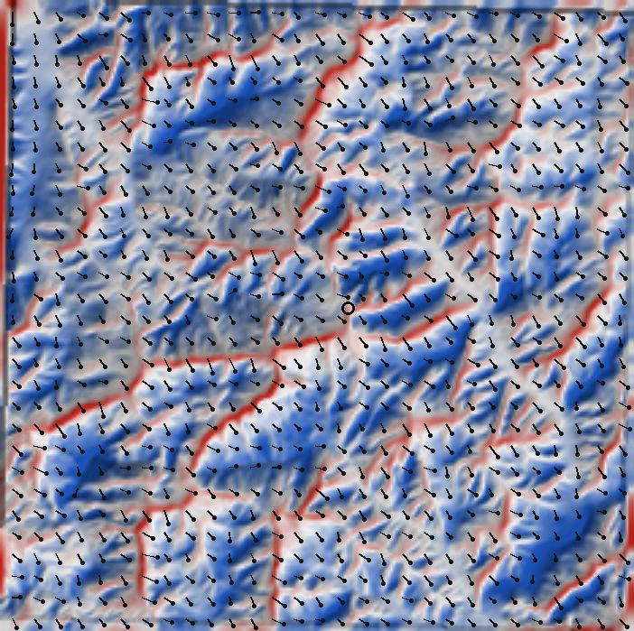

# WindNinja の調査（風速の細分化・案B）

**状態: 調査中（2026-10-16）。本体は未変更。** 背景は `docs/requirements_wind_exposure.md`「第1段の範囲外」。

やりたいこと：約11km格子の予報の風を、地形に合わせて約60〜100m の升目へ細分化する。
端末では解かず、**Actions で山域ごとに風向16方位 × 1回ずつ前もって解き、「モデルの風の何倍・何度曲がるか」の表を配る**案。

## 分かったこと（findings-01・2026-10-16）

| 確かめること | 結果 |
|---|---|
| ライセンス | **パブリックドメイン（米国政府職員の著作）＋外部の寄稿は BSD**（`LICENSE`）。計算結果を public のリポジトリに置いてよい。BSD 部分を同梱するなら著作権表示を残す（同梱はしない予定：Actions でビルドして使うだけ） |
| ビルド | **Ubuntu 24.04 で CLI だけビルドできた**（GUI・OpenFOAM なし）。下の手順で約15分（4コア）。⚠ `WITH_NOMADS_SUPPORT=OFF`・`WITH_LCP_CLIENT=OFF` にするとリンクで落ちる（既定の ON のまま）。外へ問い合わせる機能は `PHONE_HOME_QUERIES=OFF` で止めた |
| 計算時間 | **谷川岳の 14km 四方・60m の升目・質量保存の解法・4スレッドで 9.4 秒/1方位**。16方位で約2.5分/山域。51山域で約2時間（推測。⚠ 範囲を 20km 四方に固定すると約6時間 → findings-02） |
| 出力 | 風速（m/s）と風向の ASCII グリッド（UTM・60m）。`output_speed_units = mps` を書かないと **mph** で出る（最初に取り違えた） |
| 見た目 | 北西10m/s（地上10m）を一様に与えると、主稜線が赤（約1.3〜2倍）、稜線の風下・沢の中が青（0.4〜0.8倍）。谷川岳の山頂で 1.30倍。分布は 5%点 4.3・中央 8.6・95%点 15.5・最大 26.9 m/s → `tanigawa_nw10.jpg`（地形の陰影＋倍率の色＋風の向きの棒） |



## 分かったこと（findings-02・2026-10-16）

谷川岳・北西・升目 60m を基準に、条件を1つずつ変えた（`analyze.py`・`run.sh` 相当の手順は下）。

| 確かめたこと | 結果 | 意味 |
|---|---|---|
| 入力の風速を 5・10・20 m/s に変える | 倍率の差は中央 0.001・最大 0.019、向きの差は 1° 以内 | **ほぼ線形。** 風速ごとに解かなくてよい。表は**風向ごとに1枚**で、予報の風速を掛ければ済む |
| 風向を ±22.5° 変える | 倍率の差は中央 0.11・95%点 0.33 | 16方位に**丸めるだけでは粗い**（最大のずれ ±11.25°） |
| 45° 離れた2方位の平均で真ん中の方位を作る | 差は中央 0.04・95%点 0.12 | **隣の2方位を角度で按分すれば足りる**（22.5° 間隔ならさらに小さい見込み・未測定） |
| 升目 30・60・120m | 谷川岳 1.26／1.29／1.41、天神平 0.89／1.03／1.42、土合 0.90／0.92／0.93。30m は 50 秒/方位、120m は 2 秒 | **60m で足りる**（30m とほぼ同じ・120m は尾根の増速を大きく見積もる） |
| 計算する範囲を 14km → 20km 四方に広げる | 山頂の倍率 1.30 → 1.45。縁から1km 内側の倍率の差は中央 0.035・95%点 0.15。山頂で割って比べても差は残る（中央 0.06） | ⚠ **倍率は範囲の取り方で 1〜2 割変わる**（初期の風を「範囲の平均」として与えるため）。範囲は山域ごとに**同じ大きさに固定**し、外周 1km は捨てる |

### 予報の風とどう合わせるか（**A に決定**・利用者・2026-10-16）

WindNinja の倍率は「範囲の平均の地上10m風」を 1 とした値。アプリには高さの違う2つの風がある。

| 案 | 計算 | 良い点 | 危うい点 |
|---|---|---|---|
| **A. 山頂基準**（推奨） | その地点の風 ＝ 判定の風（山頂高度・ADR-0006/0011）× 倍率 ÷ 峰の倍率 | 峰では判定の風と一致する。強風の稜線を弱く見せない | 谷や樹林の中の風を強めに出す見込み（冷気が溜まる・上と切り離される状態を解いていない） |
| B. 地上10m基準 | その地点の風 ＝ モデルの地上10m風 × 倍率 | WindNinja の前提どおり | ⚠ **ADR-0006 と同じ罠。** 皇海山でモデルの地上10m風 2.7 m/s・山頂の気圧面 21 m/s。峰を大きく弱く見せる |
| C. 倍率だけ | 「モデルの風の◯倍」を塗る（m/s は出さない） | うそが混ざらない | 数値で読みたいという目的に届かない |

### 配り方の見積もり（推測）

- 20km 四方・60m（外周1km を捨てて約 300×300）× 16方位 × 倍率と向きの補正を各 8bit → **1山域 約 2.9MB**（PNG にすれば縮む見込み）。51山域で約 150MB
  → 起動時の控え（PRECACHE）には入れられない。**お気に入りの山域だけ取りに行って保存**する形（段2「お気に入りごとの DEM 保存」と同じ仕組み）
- 計算は 20km 四方・60m で 25 秒/方位 → 16方位で約7分/山域、51山域で約6時間。Actions の1ジョブ（6時間）を超えるので山域ごとに分ける。ビルドは約15分（控えれば2回目から省ける）

### 検証の手段（案）

山の稜線の観測点はほとんど無い。現実的なのは**利用者の携帯風速計で、同じ時刻に稜線と鞍部・樹林の中を測る**こと。
1回の山行で数点でも、「峰の何倍か」の比は WindNinja の倍率と直接比べられる（予報の誤差が比で消える）。

## 段3の計画：Actions で1山域の表を作る（2026-10-16）

予報の風との合わせ方は **A（山頂基準）** に決まった。端末に組み込む前に、表を作る道具を Actions で動かす。

- ワークフロー `.github/workflows/windninja.yml`（**手動実行**と、作り方を変えた非 main への push だけ。`poi.yml` と同じ形。main では走らせない）
  - WindNinja を CLI だけビルド（`actions/cache` で控える。版は `firelab/windninja` の **タグを固定**）。`PHONE_HOME_QUERIES=OFF`
  - 入力は山域 id（既定 `tanigawa`）。実行したブランチに `experiments/windninja/tables/<id>.png` と `.json` をコミット（試作の間は experiments/ に置き、Pages で配らない。端末に組み込む段で data/ へ移す）
- スクリプト `scripts/windninja/buildWindTable.py`
  - 範囲：**峰を囲む長方形の中心から一辺 32km の正方形に固定**（全山域で同じ大きさ。峰が端から 3km 未満なら止める）。外周 1km は捨てる。
    地形は地理院 DEM10B z14（30m に投影し直す）。升目 60m
  - 16方位（吹いてくる向き）× 1回。入力 10 m/s（線形なので1つで足りる）
  - 出力を緯度経度の格子（緯度方向 0.0006° ≒ 67m）に引き直し、**1枚の PNG に16方位を縦に積む**：R＝倍率×64（0〜3.98。超えたら止める）、G＝向きの曲がり（度）×127/180＋128（±180° が入る・1.4° 刻み）、A＝255（欠けは 0）
  - JSON：範囲（緯度経度）・升目の数・方位の並び・縮尺・**峰ごとの倍率（16方位）**・作った日・WindNinja の版・出典
- 端末での使い方（段4・まだ作らない）：その地点の風 ＝ 判定の風 × 倍率(地点) ÷ 倍率(選択地点)。隣の2方位を角度で按分。
  選択地点が範囲の外なら出さない
- **欠けを黙って通さない**：標高タイルの通信の失敗・出力の欠け 2% 超・倍率の頭打ち・峰の倍率の欠け・**曲がりの中央が ±15° 超（向きの約束が逆の疑い）**は、終了コード 1 で止める（コミットしない）
- 向きの約束：findings-01 の北西 10 m/s（14km 四方）で、入力 315° に対し出力 `_ang.asc` の 5%点・中央・95%点が 286°・317°・343°（＝出力も吹いてくる向き）。上の検査で毎回確かめる
- WindNinja は**通信の無い名前空間**（`sudo unshare -n`）で動かす。天気モデルを取りに行く機能（NOMADS など）は使わない
- 1山域（`tanigawa`）だけで試す。51山域を一度に入れない（生成物は履歴に残る）
- 版 4.0.0（Actions）と、findings で使った版（手元・2026-09-30 の master）で**同じ 32km 四方**を解き、峰の倍率（`peakRatio`）を並べて差を見てから使う。14km・20km の値（1.30・1.45）とは範囲が違うので比べない
- 触れないもの：本体（`sotoki_v4.html`）・`sw.js`・ABC評価・`areas.json`
- 外から取るもの（すべて Actions の中だけ・端末からは増えない）：WindNinja のソース（github.com/firelab/windninja・タグ固定）・Ubuntu の apt パッケージ・地理院 DEM10B z14（既存の情報源。1山域で約 200 枚）

## 分かったこと（findings-03・2026-10-16・段3の結果）

Actions（WindNinja 4.0.0）で谷川・上越国境（32km 四方・60m・16方位）の表を作った → `tables/tanigawa.png`・`tanigawa.json`。

| 確かめたこと | 結果 |
|---|---|
| 版の違い | 手元（2026-09-30 の master）と 4.0.0 で**同じ表**（R は全升目で一致・峰の倍率の差 0） |
| 時間 | 1方位 約23秒（Actions・4コア）。16方位で約6分＋ビルド約5分。手元（4コア）は約55秒/方位 |
| 大きさ | PNG 3.96 MB（450×450×16方位）。圧縮はほとんど効かない |
| 倍率の幅 | 最大 3.01（尾根の一部）。曲がりは 95%点で約29°、90° を超える升目が 0.02% 前後（風がほぼ止まる升目） |
| 峰の倍率（北・東・南・西） | 苗場山 1.40・1.26・1.40・1.26／平標山 1.66・1.60・1.66・1.60／**谷川岳 1.45・2.36・1.45・2.36**／巻機山 1.69・1.17・1.69・1.17 |

### ⚠⚠ 風向が逆でも、風速の分布がまったく同じ

**北風と南風、東風と西風で、倍率が全升目で一致する**（差 0。曲がりも同じ値で、流れは向きだけ反対）。
質量保存の解法は「地形に沿って流れの量を合わせる」だけで、勢い（慣性）を解かない。流れを逆向きにしても式が同じなので、答えも逆向きになるだけ。

- 出せるもの：**稜線・肩での増速、鞍部（コル）への集まり、谷筋への寄り**（風向が逆でも同じ場所）
- **出せないもの：風下の陰**（稜線を越えた裏で風が弱まる・剥がれて巻く）。風上の斜面と風下の斜面が同じ倍率になる
  → 文献の「風下の剥離が苦手」（Wagenbrenner ら）は「苦手」どころか**この解法では原理的に出ない**
- BC で知りたい「風の陰（雪の溜まる斜面）」は、v4.177.0 の「風の当たり方」（Sx）の方が表せている。WindNinja の表はそれを置き換えない
- 逆向きの方位は同じ表で済むので、**表は 8方位で足りる**（大きさは半分の約 2 MB）

### 次の選択（利用者の判断）

| 案 | 中身 | 良い点 | 弱い点 |
|---|---|---|---|
| 1. このまま使う | 質量保存の倍率で稜線・鞍部の増速を出す（m/s・案A）。風下の陰は「風の当たり方」の層で見る | すぐ進められる。8方位・約 2 MB | 風下の斜面の風を強めに出す（風上と同じ倍率）。数値だけ見ると誤解しうる |
| 2. 勢いも解く版を調べる | WindNinja の運動量の解法（OpenFOAM を使う RANS）。風下の剥離を解く（Wagenbrenner ら 2019 で風上・風下とも有意に良い） | 風下の陰が出る。物理として筋がよい | 重い（OpenFOAM の導入・1方位あたり数十分〜の見込み・**未測定**）。外から取るもの（OpenFOAM）が増える |
| 3. 倍率に Sx の遮蔽を掛ける | 質量保存の倍率 × 風下で弱める係数 | 安く陰が出る | 係数は経験的な当て推量（今の粒子の補正と同じ問題） |

## 段4の計画：運動量の解法を調べる（案2・利用者の決定 2026-10-16）

- `.github/workflows/windninja-momentum.yml`（手動実行と、調べ方を変えた非 main への push だけ）。OpenFOAM 11 を dl.openfoam.org の apt から入れ（WindNinja 公式の手順と同じ）、
  WindNinja 4.0.0 を運動量の解法つきでビルドする。⚠ 開発環境からは dl.openfoam.org に届かない（2026-10-16 に curl で試してプロキシが 403 で拒否）ので Actions で試す。
  4.0.0 のタグに `src/ninjafoam/11`・`data/ninjafoam/11` があり、CLI に `momentum_flag`・`mesh_resolution` があることは git で確かめた（`mesh_choice` と `mesh_resolution` は同時に使えない）
- 谷川岳の 14km 四方・60m で、**質量保存と運動量 × 北西・南東の4回**を解く（`momentum/run.sh`。通信の無い名前空間で）
- `momentum/compare.py` で比べる：①北西と南東で倍率が違うか（質量保存は同じだった）②**風上が開けた所（Sx＜−10°）と風下の陰（Sx＞10°）の平均の倍率**
  ③谷川岳の山頂の倍率 ④1方位の時間。画像と要約を `momentum/out/` にコミット（Pages では配らない）
- 外から取るもの（Actions の中だけ）：OpenFOAM 11（dl.openfoam.org の apt）が増える。端末からは増えない
- 判断の目安：風下の陰の倍率が風上より明らかに小さく、1方位が Actions で 30 分程度までなら、表づくりを運動量の解法に切り替える案を出す

## 分かったこと（findings-04・2026-10-16・段4の結果）

Actions で OpenFOAM 11 を入れ、WindNinja 4.0.0 の運動量の解法で谷川岳 14km 四方を解いた（`momentum/out/`）。

| 確かめたこと | 結果 |
|---|---|
| 導入 | OpenFOAM 11（dl.openfoam.org）と運動量の解法つきのビルドは通る。⚠ bashrc は `-e` のまま読むと落ちる。⚠ スレッド数は**物理コアの数まで**（4 vCPU の runner で 2） |
| 既定の升目（約 10 万） | 1方位 約 2〜3 分で「解けた」が、**急な地形で simpleFoam が発散し、WindNinja が自動で地形をならして解き直していた**（ならした回数 4）。結果は塊状にぼやけ、谷川岳の山頂が北西で 0.34 倍・全体の中央 0.5 倍と、質量保存（1.43 倍・0.86 倍）とかけ離れる |
| 升目 50 万 | 22 分。**ならしても最後まで発散して失敗** |
| 升目 150 万 | 51 分。**同じく失敗** |
| 逆向きの差 | 既定の升目では北西と南東で倍率が違う（差の中央 0.39）。風下の陰（Sx＞10°）は風上の約半分 → 方向としては期待どおり。ただし地形をならした上の解なので、細かい尾根・沢の陰としては使えない |

**結論：谷川岳のような急な山では、WindNinja の運動量の解法は（既定の設定では）細かい地形のまま解けない。**
解けるのは地形をならしたときだけで、それでは「細かい尾根と沢の風」という目的に合わない。
設定（反復回数・升目の作り方・乱流の模型）を詰める余地はあるが、1回の試行が数十分かかり、見通しは立たない（推測）。

### 次の方針（**A に決定**・利用者・2026-10-16）

**質量保存の表を使う**（稜線・鞍部・谷筋の増速を m/s で・案A の山頂基準）。風下の陰は v4.177.0 の「風の当たり方」（Sx）の層で見る。
運動量の解法は使わない（`windninja-momentum.yml` と `momentum/` は調べた記録として残す。手動実行だけ）。
- 表は **8方位**（0〜157.5°）に減らす。逆向きは同じ表（findings-03）。大きさは約半分
- 次は端末で読む段（段5）の要件書。⚠ 数値は風下の斜面で強めに出る（風上と同じ倍率）ことを画面と about に明記する

## まだ分からないこと

- **合っているか**。質量保存の解法は稜線の増速は得意、**風下の剥離（巻き返し）は苦手**（Wagenbrenner ら 2016・2019）。
  熱の風（谷風・山風）はほぼ検証されていない。検証の手段（山の観測）が少ない
- **入力の高さの合わせ方**（→ findings-02 の案 A/B/C）。WindNinja の「一様な初期の風」は地上10mで与える。アプリの判定は山頂高度の気圧面の風を使う（ADR-0011）。
  どちらを「1倍」とみなすか（例：山頂の倍率で割り戻して、山頂で予報の値に一致させる）は決めていない
- 端末に配る表の形（→ findings-02 の見積もり）

## 手順（再現）

```sh
# 依存（Ubuntu 24.04）
apt-get install -y pkg-config libboost-program-options-dev libboost-date-time-dev libboost-test-dev libshp-dev libgdal-dev gdal-bin libnetcdf-dev
git clone --depth 1 https://github.com/firelab/windninja.git src
mkdir build && cd build
cmake -DNINJA_GUI=OFF -DNINJAFOAM=OFF -DPHONE_HOME_QUERIES=OFF -DSUPRESS_WARNINGS=ON -DCMAKE_BUILD_TYPE=Release ../src && make -j4

# 地形（地理院 DEM10B z14 → Webメルカトル → UTM 54N・30m）
python3 fetchDem.py 36.8375 138.9300 6 14 dem_png tanigawa_merc.asc
gdalwarp -s_srs EPSG:3857 -t_srs EPSG:32654 -tr 30 30 -r bilinear -srcnodata -9999 -dstnodata -9999 tanigawa_merc.asc tanigawa_utm30.tif

# 解く（WINDNINJA_DATA はソースの data/）
WINDNINJA_DATA=../src/data ./src/cli/WindNinja_cli tanigawa_nw.cfg

# findings-02：条件を変えて解き、比べる（run.sh <地形> <風向> <風速> <升目m> <名前> → out_<名前>/）
./run.sh tanigawa_utm30.tif 315 10 60 base   # ほかに s5・s20（風速）・d293・d338（風向）・r30・r120（升目）
python3 analyze.py .
```

出典：地理院タイル（標高タイル）を加工して作成。
